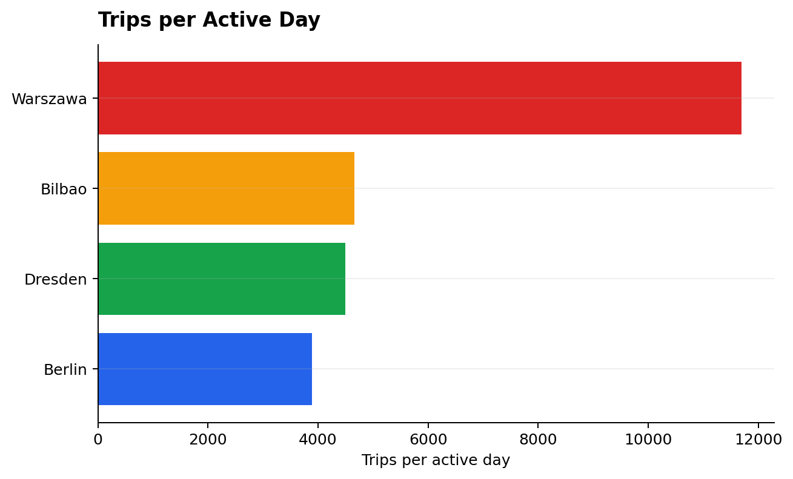
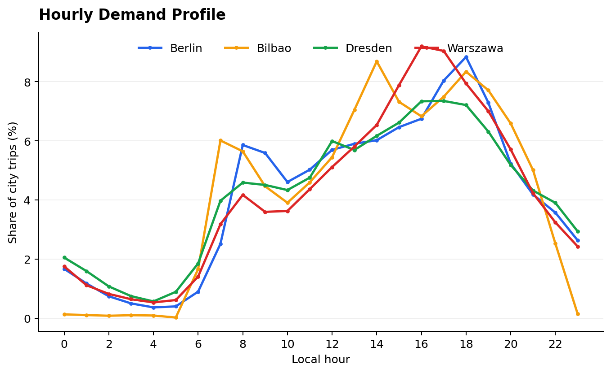
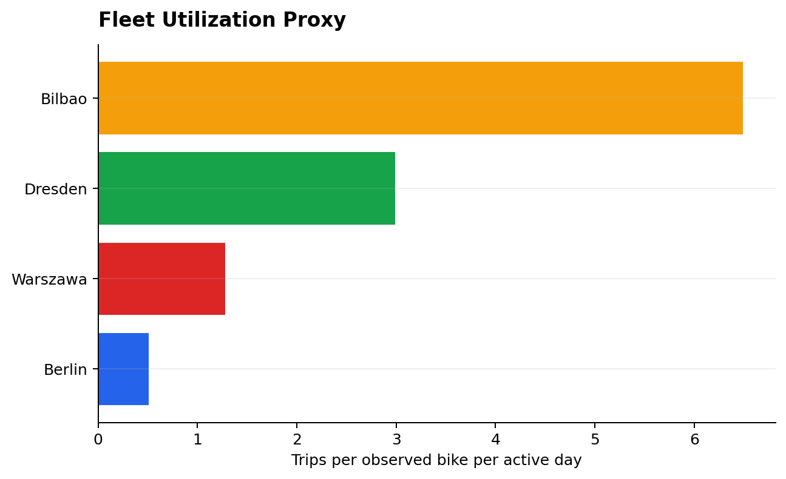

# European Bike Sharing Analytics

Comparative analysis of bike-sharing demand, trip behavior, station activity,
and observed fleet utilization in Berlin, Warszawa, Dresden, and Bilbao.

The project turns a large relational CSV export into a compact analytical
workflow built around DuckDB SQL, Python, Parquet, a completed Jupyter report,
and a local Streamlit dashboard. It is designed to answer practical comparison
questions without attributing observed patterns to causes outside the dataset.

## Business question

How do bike-sharing usage patterns differ across selected European cities, and
what patterns can be identified in demand, trip behavior, station activity,
and fleet utilization?

## Dataset

The source is the official
[TUM European Bike Sharing Dataset](https://github.com/TUMFTM/european-bike-sharing-dataset),
published with the 2025 *Transportation* article
[Data-Driven Insights into (E-)Bike-Sharing](https://doi.org/10.1007/s11116-025-10661-2).
The publication year is not the observation year: selected trips run from
**26 August 2022 to 15 July 2023**. Coverage differs by city, so normalized
metrics are reported alongside totals.

The pipeline uses the upstream `trips`, `cities`, `stations`, `bikes`, and
`bike_types` tables. Unix UTC timestamps are converted with the timezone stored
in `cities.csv`.

## Cities

| City | Source city ID(s) | Trips | Active days | Stations | Inclusion |
|---|---:|---:|---:|---:|---|
| Berlin | 362 | 1,213,498 | 312 | 2,815 | Preferred city; quality thresholds passed |
| Warszawa | 210, 812 | 2,784,538 | 238 | 330 | Preferred city; both official Warszawa records combined |
| Dresden | 685 | 1,403,079 | 312 | 278 | Preferred city; quality thresholds passed |
| Bilbao | 532 | 1,438,586 | 309 | 44 | Preferred city; quality thresholds passed |

No city was replaced. Warszawa has two canonical upstream records,
`Warszawa` and `Warszawa - 2023`; both are retained under one city label.

## Key KPIs

| City | Trips / active day | Median duration | Median distance | Weekend share | Peak hour | Fleet utilization proxy |
|---|---:|---:|---:|---:|---:|---:|
| Warszawa | 11,700 | 15 min | 1.74 km | 27.8% | 16:00 | 1.28 |
| Bilbao | 4,656 | 12 min | 1.37 km | 16.7% | 14:00 | 6.49 |
| Dresden | 4,497 | 9 min | 1.18 km | 23.0% | 17:00 | 2.99 |
| Berlin | 3,889 | 15 min | 1.85 km | 28.7% | 18:00 | 0.51 |

`Fleet utilization proxy = trips / observed bikes / active days`. It measures
activity among bikes seen in trips, not verified fleet capacity.

## Key findings

1. Warszawa had the highest absolute and normalized demand: 2.78 million trips
   and about 11,700 trips per active day.
2. Absolute demand and observed-bike utilization produced different rankings.
   Bilbao had fewer trips per day than Warszawa but the highest fleet
   utilization proxy at 6.49.
3. Peak timing differed: Bilbao peaked at 14:00, Warszawa at 16:00, Dresden at
   17:00, and Berlin at 18:00 local time.
4. Weekend demand per observed day was slightly higher in Berlin and Warszawa,
   but 24% lower than weekdays in Dresden and 48% lower in Bilbao.
5. Dresden had the shortest median trip at 9 minutes and 1.18 km. Berlin had
   the longest median distance at 1.85 km.
6. Station coverage was nearly complete in Bilbao and above 95% in Warszawa,
   but much lower in Berlin and Dresden. Cross-city station rankings are not
   treated as directly comparable.
7. Bilbao trips were entirely mapped to electric-assist bikes. Warszawa's
   observed electric-assist share was 11.5%; Berlin and Dresden were almost
   entirely human-powered in the source mapping.

## Practical insights

- Align rebalancing attention with each city's observed demand peak instead of
  applying one common peak-hour assumption.
- Use trips per active day alongside total trips when comparing cities with
  unequal observation coverage.
- Treat Bilbao's high trips-per-observed-bike value as a signal for operational
  review, not a precise capacity utilization rate.
- Prioritize station-level decisions in Bilbao and Warszawa; free-floating
  activity limits station conclusions in Berlin and especially Dresden.

## Visual highlights







## Dashboard

The Streamlit dashboard reads only committed processed aggregates. It provides
a city selector, weekday/weekend filter, six KPI cards, hourly and day-of-week
views, station activity, propulsion mix, trip characteristics, and a cross-city
comparison.

```powershell
streamlit run dashboard/app.py
```

## Tech stack

- SQL and DuckDB for profiling, aggregation, joins, window functions, and local analytics
- Python and Pandas for orchestration and compact result handling
- Parquet and PyArrow for reusable analytical storage
- Jupyter and Plotly for the executed analytical report
- Matplotlib for committed static figures
- Streamlit for the local dashboard
- pytest and Git for validation and version history

## Project structure

```text
.
├── dashboard/app.py
├── data/
│   ├── README.md
│   └── processed/             # compact committed aggregates
├── notebooks/
│   └── european_bike_sharing_analysis.ipynb
├── reports/figures/           # eight committed PNG figures
├── scripts/
│   ├── prepare_data.py
│   └── run_analysis.py
├── sql/                       # nine executable DuckDB queries
├── src/                       # paths, preparation, metrics, charts
└── tests/                     # lightweight unit and dashboard tests
```

## How to run

Python 3.11+ is recommended. The first full preparation downloads the official
878 MiB archive and needs roughly 4 GB of temporary disk space. Raw and interim
files are ignored by Git.

```powershell
python -m venv .venv
.\.venv\Scripts\Activate.ps1
python -m pip install -r requirements.txt

# Optional inexpensive schema/JOIN check
python scripts/prepare_data.py --sample

# One full preparation pass, then analysis on the filtered Parquet subset
python scripts/prepare_data.py
python scripts/run_analysis.py

jupyter notebook notebooks/european_bike_sharing_analysis.ipynb
streamlit run dashboard/app.py
pytest
```

## Data quality and cleaning

The selected source rows contained no exact duplicates, missing bike IDs, or
invalid timestamps. The pipeline retained all 6,839,701 valid trip records.
It marked 5,009 durations outside 1 minute to 6 hours as unavailable for
duration statistics. Distance values are used only when positive, no more than
100 km, and consistent with an implied speed no greater than 60 km/h.

Missing station IDs are retained because they are valid for free-floating
systems. Their prevalence is reported and station analysis uses only observed
station links.

## Data source and license

The upstream dataset and derived data are licensed under
[CC BY-NC 4.0](https://creativecommons.org/licenses/by-nc/4.0/). The MIT license
in this repository applies only to project code and documentation. Raw source
files are not redistributed here; see [data/README.md](data/README.md) for the
reproduction flow and attribution.

## Limitations

- Active-day coverage differs: Warszawa has 238 days versus 309–312 elsewhere.
- Observed bike IDs may not equal complete registered fleet capacity.
- Station analysis is less representative for Berlin and Dresden because of
  free-floating trips and missing station links.
- Distance is upstream straight-line endpoint distance, not routed cycling distance.
- The data does not include weather, pricing, infrastructure, or demographics,
  so the analysis is descriptive and does not claim causality.
- Combining Warszawa's two official source records supports a city-level view
  but does not imply identical service configurations.

