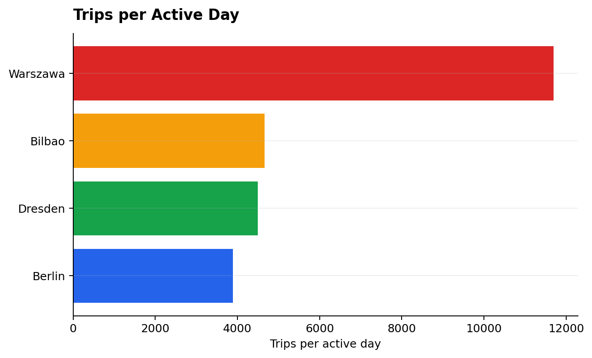
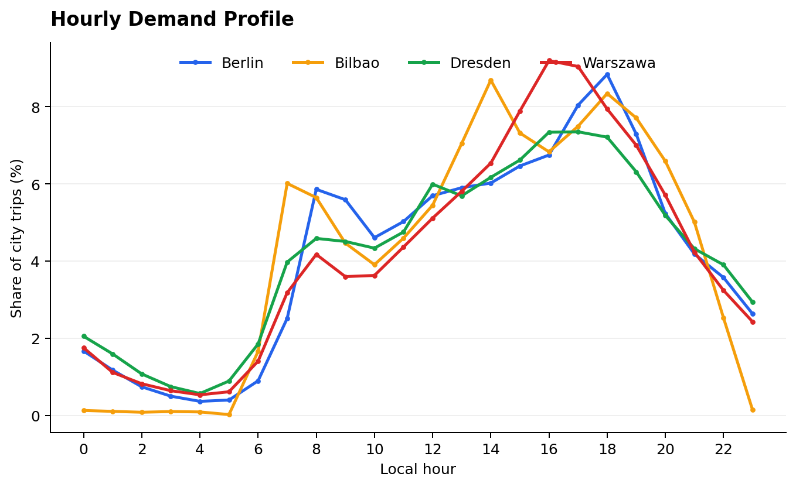
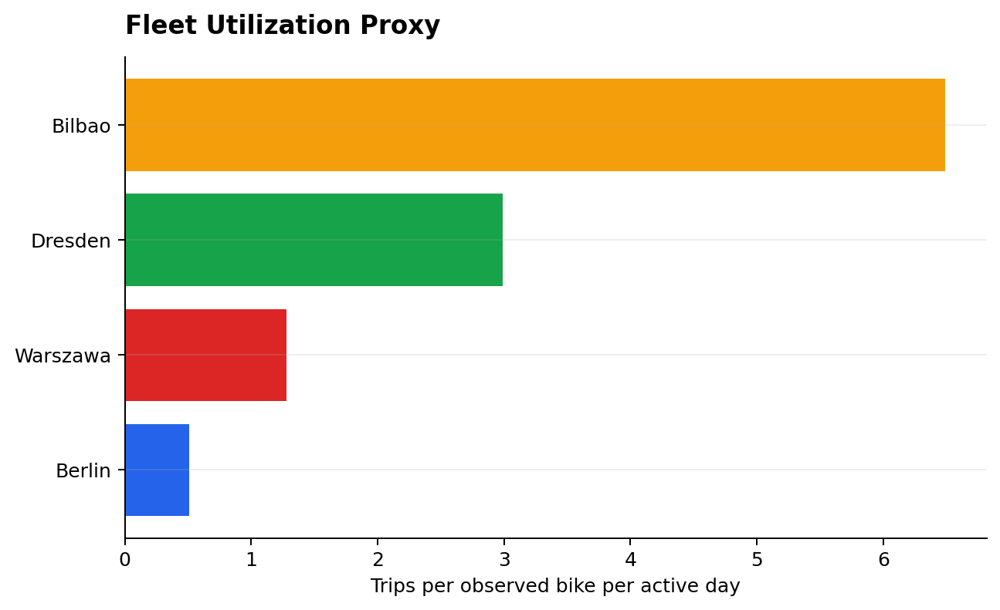

# European Bike Sharing Analytics

[English version](README.md)

Сравнительный анализ спроса на велошеринг, характеристик поездок, активности
станций и использования наблюдаемого парка велосипедов в Берлине, Варшаве,
Дрездене и Бильбао.

Проект преобразует крупный набор связанных CSV-таблиц в компактный и
воспроизводимый аналитический процесс на DuckDB SQL, Python и Parquet. Результаты
представлены в выполненном Jupyter Notebook, статических графиках и локальном
Streamlit dashboard. Анализ описывает наблюдаемые различия, но не приписывает
им причины, которых нет в исходных данных.

## Аналитический вопрос

Чем отличаются паттерны использования велошеринга в выбранных европейских
городах и какие различия можно обнаружить в спросе, характеристиках поездок,
активности станций и использовании парка велосипедов?

## Данные

Официальный источник —
[TUM European Bike Sharing Dataset](https://github.com/TUMFTM/european-bike-sharing-dataset),
опубликованный вместе со статьёй 2025 года в журнале *Transportation*:
[Data-Driven Insights into (E-)Bike-Sharing](https://doi.org/10.1007/s11116-025-10661-2).

Год публикации не является периодом наблюдений. Выбранные поездки относятся к
периоду с **26 августа 2022 года по 15 июля 2023 года**. Временной охват городов
различается, поэтому вместе с абсолютными значениями используются
нормализованные показатели.

Pipeline использует таблицы `trips`, `cities`, `stations`, `bikes` и
`bike_types`. Unix timestamps в UTC преобразуются в локальное время по часовому
поясу из `cities.csv`.

## Выбранные города

| Город | ID в источнике | Поездки | Активные дни | Станции | Причина включения |
|---|---:|---:|---:|---:|---|
| Berlin | 362 | 1 213 498 | 312 | 2 815 | Предпочтительный город; прошёл проверку качества |
| Warszawa | 210, 812 | 2 784 538 | 238 | 330 | Объединены обе официальные записи Варшавы |
| Dresden | 685 | 1 403 079 | 312 | 278 | Предпочтительный город; прошёл проверку качества |
| Bilbao | 532 | 1 438 586 | 309 | 44 | Предпочтительный город; прошёл проверку качества |

Замена городов не потребовалась. В исходном наборе Варшава представлена двумя
записями: `Warszawa` и `Warszawa - 2023`. Обе записи объединены под одной
аналитической меткой `Warszawa`.

## Основные KPI

| Город | Поездок в активный день | Медианная длительность | Медианное расстояние | Доля выходных | Пиковый час | Fleet utilization proxy |
|---|---:|---:|---:|---:|---:|---:|
| Warszawa | 11 700 | 15 мин | 1,74 км | 27,8% | 16:00 | 1,28 |
| Bilbao | 4 656 | 12 мин | 1,37 км | 16,7% | 14:00 | 6,49 |
| Dresden | 4 497 | 9 мин | 1,18 км | 23,0% | 17:00 | 2,99 |
| Berlin | 3 889 | 15 мин | 1,85 км | 28,7% | 18:00 | 0,51 |

`Fleet utilization proxy = поездки / наблюдаемые велосипеды / активные дни`.
Показатель отражает активность велосипедов, встречающихся в поездках, но не
является точной оценкой загрузки всего зарегистрированного парка.

## Основные выводы

1. Warszawa лидирует по абсолютному и нормализованному спросу: 2,78 млн поездок
   и около 11 700 поездок на активный день.
2. Рейтинг по общему спросу отличается от рейтинга по использованию наблюдаемого
   парка. В Bilbao меньше поездок в день, чем в Warszawa, но максимальный fleet
   utilization proxy — 6,49.
3. Пиковое время различается: 14:00 в Bilbao, 16:00 в Warszawa, 17:00 в Dresden
   и 18:00 в Berlin по местному времени.
4. Средний спрос за наблюдаемый выходной немного выше в Berlin и Warszawa, но
   на 24% ниже буднего уровня в Dresden и на 48% ниже в Bilbao.
5. Самые короткие поездки наблюдаются в Dresden: медиана составляет 9 минут и
   1,18 км. Наибольшее медианное расстояние зафиксировано в Berlin — 1,85 км.
6. Данные о станциях почти полностью заполнены в Bilbao и более чем на 95% в
   Warszawa, но заметно хуже представлены в Berlin и Dresden. Поэтому рейтинги
   станций не используются как прямое сравнение городов.
7. Все поездки Bilbao сопоставлены с электровелосипедами. В Warszawa наблюдаемая
   доля электровелосипедов составляет 11,5%, а Berlin и Dresden представлены
   почти исключительно обычными велосипедами.

## Практические наблюдения

- Планировать повышенное внимание к ребалансировке с учётом собственного
  пикового часа каждого города.
- Использовать поездки на активный день вместе с общим количеством поездок,
  если временной охват городов различается.
- Рассматривать высокое значение Bilbao по поездкам на наблюдаемый велосипед
  как сигнал для дополнительного операционного анализа, а не как точную
  загрузку парка.
- Использовать станционный анализ прежде всего для Bilbao и Warszawa. Большая
  доля free-floating поездок ограничивает такие выводы для Berlin и Dresden.

## Основные визуализации







## Dashboard

Streamlit dashboard работает только с компактными обработанными таблицами и не
загружает исходный dataset при запуске. Доступны выбор города, фильтр будней и
выходных, шесть KPI, почасовой и недельный спрос, активность станций, типы
велосипедов, характеристики поездок и межгородское сравнение.

```powershell
streamlit run dashboard/app.py
```

## Технологии

- SQL и DuckDB — profiling, JOIN, агрегации, оконные функции и локальная аналитика
- Python и Pandas — организация pipeline и работа с результатами
- Parquet и PyArrow — компактное повторно используемое хранение
- Jupyter и Plotly — выполненный аналитический отчёт
- Matplotlib — статические графики для GitHub
- Streamlit — локальный интерактивный dashboard
- pytest и Git — проверки и история разработки

## Структура проекта

```text
.
├── dashboard/app.py
├── data/
│   ├── README.md
│   └── processed/             # компактные агрегаты в Git
├── notebooks/
│   └── european_bike_sharing_analysis.ipynb
├── reports/figures/           # восемь PNG-графиков
├── scripts/
│   ├── prepare_data.py
│   └── run_analysis.py
├── sql/                       # девять выполняемых DuckDB-запросов
├── src/                       # подготовка данных, метрики и визуализации
└── tests/                     # небольшие unit и dashboard tests
```

## Запуск проекта

Рекомендуется Python 3.11 или новее. Первый полный запуск загружает официальный
архив размером около 878 MiB и требует примерно 4 ГБ временного места. Исходные
и промежуточные файлы исключены из Git.

```powershell
python -m venv .venv
.\.venv\Scripts\Activate.ps1
python -m pip install -r requirements.txt

# Быстрая проверка схемы и JOIN на sample data
python scripts/prepare_data.py --sample

# Полная подготовка и анализ отфильтрованного Parquet subset
python scripts/prepare_data.py
python scripts/run_analysis.py

jupyter notebook notebooks/european_bike_sharing_analysis.ipynb
streamlit run dashboard/app.py
pytest
```

## Очистка и качество данных

В выбранных исходных строках не обнаружены полные дубликаты, пропущенные bike
IDs или некорректные timestamps. В анализ спроса вошли все 6 839 701 поездок.

Для 5 009 поездок длительность находилась за пределами от 1 минуты до 6 часов.
Эти записи сохранены для подсчёта спроса, но их длительность исключена из
статистики поездок. Расстояние используется только при положительном значении
не более 100 км и расчётной скорости не выше 60 км/ч.

Пропущенные station IDs сохраняются, поскольку они допустимы для free-floating
систем. Их доля учитывается при интерпретации станционного анализа.

## Источник и лицензия

Исходный dataset и производные наборы данных распространяются по лицензии
[Creative Commons Attribution-NonCommercial 4.0 International](https://creativecommons.org/licenses/by-nc/4.0/).
MIT License в этом репозитории относится только к коду и документации проекта.
Полные исходные данные не размещаются в репозитории; порядок воспроизведения и
атрибуция описаны в [data/README.md](data/README.md).

## Ограничения

- Временной охват различается: 238 активных дней для Warszawa и 309–312 для
  остальных городов.
- Наблюдаемые bike IDs могут не совпадать с полным зарегистрированным парком.
- Station analysis менее репрезентативен для Berlin и Dresden из-за
  free-floating поездок и пропущенных связей со станциями.
- Расстояние в источнике рассчитано по прямой между точками, а не по маршруту.
- Dataset не содержит погоду, тарифы, инфраструктуру и демографию, поэтому
  анализ не делает причинных выводов.
- Объединение двух официальных записей Warszawa создаёт городской уровень
  анализа, но не означает идентичность конфигураций сервиса.
