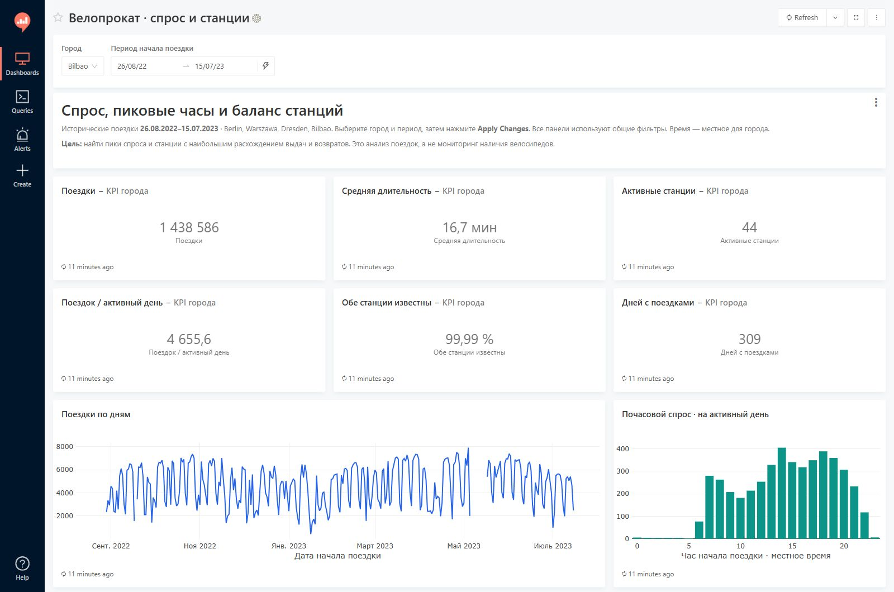
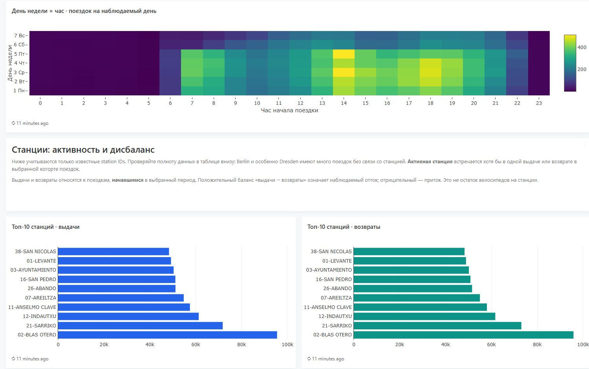
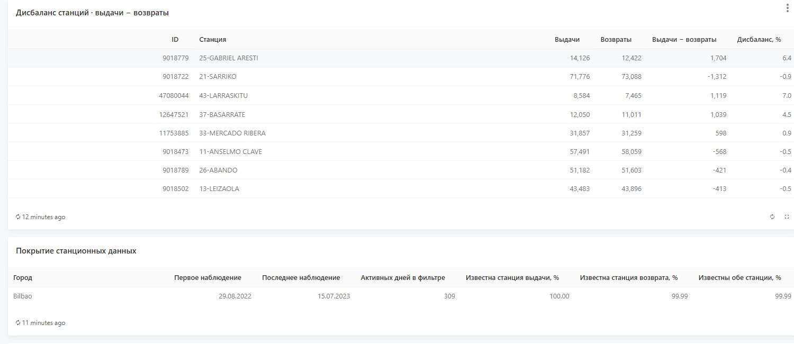

# Redash BI dashboard · bike-sharing demand and stations

[Русская версия](README_RU.md) · [Main analysis](../README.md)

Historical BI reporting on **6,839,701 trips** in Berlin, Warszawa, Dresden, and
Bilbao. The dashboard connects Redash to PostgreSQL marts and helps inspect
demand peaks and station flows. City and trip-start date filters apply to every panel.

## Screenshot gallery

The screenshots below are publicly viewable without an account or installation.
They show **Bilbao, 26 August 2022–15 July 2023**. An interactive instance can be
reproduced locally; this repository does not link to a hosted Redash demo.

### KPIs and demand

1,438,586 trips, 44 observed active stations, 309 active days, and 16.7-minute
mean valid trip duration. The daily series and hourly profile share the filters.



### Peak hours and station activity

The heatmap shows mean trips per observed date of each weekday. Station charts
rank departures and returns separately; both use the same selected trip cohort.



### Station balance and data coverage

The balance table ranks absolute departure/return differences. Coverage remains
visible because missing station links limit interpretation, particularly in Dresden.



## What is implemented

- Six KPI cards: trips, mean valid duration, observed active stations, trips per
  active day, share with both station IDs, and active days.
- Daily demand, normalized hourly demand, and weekday × hour heatmap.
- Top-10 departure stations and return stations; top-15 station imbalances.
- Shared single-city and date-range parameters, editable SQL, and CSV exports
  through the native Redash interface.
- A PostgreSQL role restricted to reading the analytical schema.

## Run locally

Requirements: Docker with Linux containers, Python 3.11+, and about 4 GB available
to Docker. Run from the repository root:

```powershell
python -m pip install -r redash/requirements.txt
python redash/scripts/manage_stack.py setup
```

Open **http://localhost:5001**, then select **Велопрокат · спрос и станции** in
Dashboards. The generated local login is stored in `redash/private/login.txt`.
Choose a city and date range, then click **Apply Changes**.

Compact Parquet marts are committed, so this setup does **not** download the
878 MiB source archive. The setup validates and converts them into ignored CSV
files for PostgreSQL COPY, then creates queries, visualizations, and the dashboard.

Start or stop an existing instance from the repository root:

```powershell
python redash/scripts/manage_stack.py start
python redash/scripts/manage_stack.py stop
```

Stop preserves the database. The Compose project is `bike-redash`; its web port
is bound to `127.0.0.1:5001`. Database and Redis ports are not published.
Credentials are generated locally; `.env`, `private/`, generated CSV files,
and runtime IDs are ignored by Git.

## Architecture and data

```text
Original cleaned trip-level Parquet
    -> DuckDB export
    -> committed compact Parquet marts
    -> generated CSV / PostgreSQL COPY
    -> bike.* analytical tables
    -> parameterized Redash SQL / native visualizations
```

| Mart | Grain | Rows |
|---|---|---:|
| `demand_hourly` | city × local trip-start date × hour | 26,520 |
| `station_daily` | city × trip-start date × station ID | 425,381 |
| `city_coverage` | city | 4 |

The committed marts total about **1.6 MiB**. Provenance and reconciliation counts
are recorded in [data_manifest.json](data_manifest.json). The original cleaned
trip file is identified by SHA-256. The large raw archive and trip-level file
are not redistributed in this BI extension.

To rebuild the marts from the original project's cleaned dataset:

```powershell
python redash/scripts/manage_stack.py setup --source .
```

This requires `data/interim/trips_selected.parquet`, produced by the
[original preparation pipeline](../README.md#how-to-run).

## Definitions and interpretation

- **Trips:** all retained trips, including trips whose duration is unavailable.
- **Mean duration:** sum of valid durations / valid-duration trip count, weighted
  across all selected trips. Valid duration is 1–360 minutes. The original
  research notebook reports **medians**, so those values intentionally differ.
- **Active day:** a local date with observed trips. Unobserved dates are NULL in
  the daily series; missing observations are not asserted to mean zero demand.
- **Hourly demand:** trips at that hour / selected active dates. Heatmap cells
  instead divide by observed dates of the corresponding weekday, including
  zero-trip hours on those observed dates.
- **Active station:** a distinct station ID appearing as a departure or return
  in the selected trip cohort; this is not the catalog's total station count.
- **Station balance:** departures − returns for trips **starting** in the
  selected date range. Positive means observed net outflow, negative net inflow.
  Returns are attributed to trip-start date, not their physical completion time.
  This is neither real-time availability nor a reconstruction of station stock.
- Dates and hours use the source city's local timezone. Warszawa combines both
  official upstream city records. Station rankings should be read within a city
  alongside coverage, especially for Berlin and Dresden.

## Validation

[validation_report.json](validation_report.json) records live Redash checks on
5 November 2026: all four cities, full observation range and a separate week,
trip totals, weighted means, active stations, heatmap normalization, a no-data
range, and shared widget mappings. Results were reconciled to the cleaned
trip-level source, and the interface was reviewed in a browser.

```powershell
# Bundled data integrity plus the project's existing unit/dashboard tests
python -m pip install -r requirements.txt
python -m pytest

# Optional live Redash/source reconciliation; requires original trip-level data
python redash/scripts/validate_dashboard.py --source .
```

## Source and license

[TUM European Bike Sharing Dataset](https://github.com/TUMFTM/european-bike-sharing-dataset),
published with [Data-Driven Insights into (E-)Bike-Sharing](https://doi.org/10.1007/s11116-025-10661-2).
The source and derived marts are **CC BY-NC 4.0**. Code and documentation use
the repository's MIT license. Observations are from **2022–2023**, not the 2025
publication year. The dashboard supports descriptive analysis, not causal claims.
