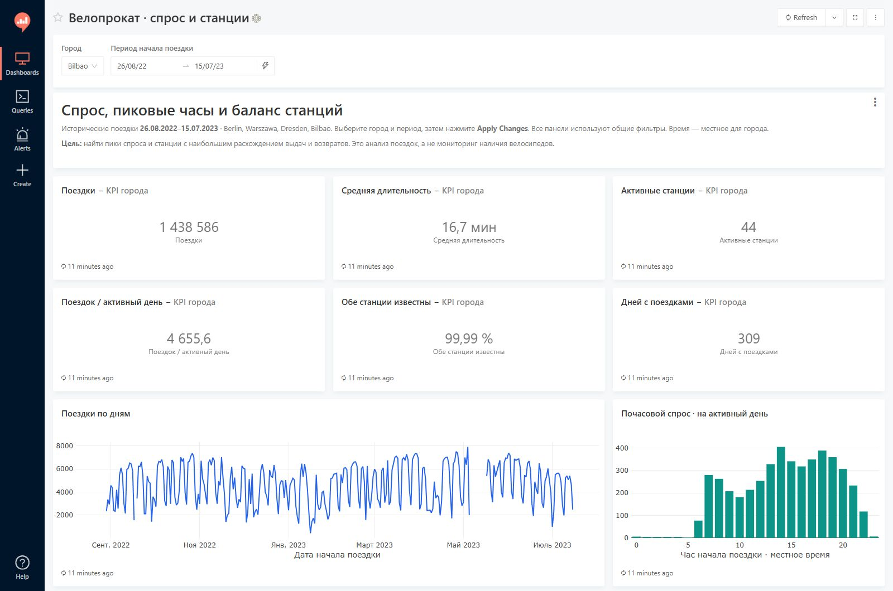
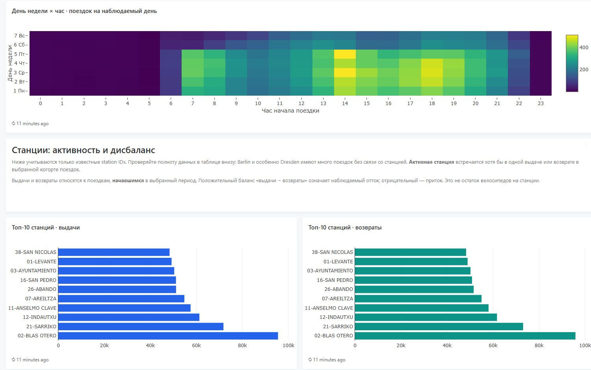
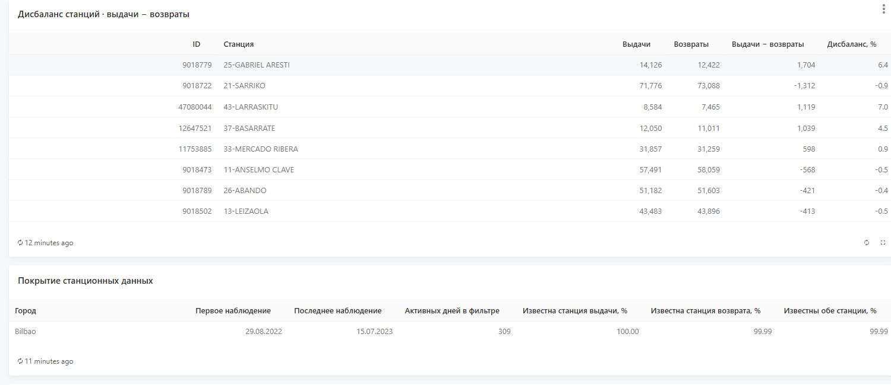

# BI-дашборд в Redash: спрос и станции велопроката

[English version](README.md) · [Основное исследование](../README_RU.md)

Дашборд на **6 839 701 поездке** в Berlin, Warszawa, Dresden и Bilbao. Связка
Python / DuckDB → PostgreSQL → Redash позволяет изучать пики спроса и потоки
между станциями. Общие фильтры города и даты начала поездки действуют на все панели.

## Посмотреть без установки

Это реальные скриншоты локального Redash, доступные всем без регистрации.
Показан **Bilbao за 26.08.2022–15.07.2023**. Публичного интерактивного сервера
у проекта пока нет; локальный адрес localhost не предназначен для рекрутера.

### KPI и динамика спроса

1 438 586 поездок, 44 наблюдаемые активные станции, 309 активных дней,
средняя валидная длительность 16,7 минуты. Фильтры едины для карточек и графиков.



### Пиковые часы и активность станций

Тепловая карта нормализована на число наблюдаемых дат соответствующего дня недели.
Станции выдачи и возврата ранжируются отдельно.



### Баланс станций и полнота данных

Таблица показывает станции с наибольшим расхождением выдач и возвратов.
Рядом — полнота станционных связей, необходимая для интерпретации результатов.



## Возможности

- Шесть KPI: поездки, средняя валидная длительность, активные станции,
  поездки на активный день, доля поездок с обеими станциями и число активных дней.
- Динамика по дням, почасовой профиль и тепловая карта «день недели × час».
- Топ-10 станций выдачи и возврата, топ-15 станций по модулю дисбаланса.
- Общие параметры, редактируемый SQL и экспорт результатов в интерфейсе Redash.
- Подключение к PostgreSQL отдельной ролью с правами чтения аналитической схемы.

## Запуск из корня репозитория

Нужны работающий Docker с Linux containers, Python 3.11+ и около 4 ГБ,
доступных Docker.

```powershell
python -m pip install -r redash/requirements.txt
python redash/scripts/manage_stack.py setup
```

Откройте **http://localhost:5001** и дашборд **Велопрокат · спрос и станции**.
Локальные логин и пароль создаются в `redash/private/login.txt`. После выбора
города и периода нажмите **Apply Changes**.

Компактные Parquet-витрины уже включены в Git: большой исходный архив скачивать
для запуска BI-дашборда не нужно. Скрипт проверит витрины, подготовит CSV для
PostgreSQL COPY и создаст нативные запросы и визуализации Redash.

```powershell
python redash/scripts/manage_stack.py start
python redash/scripts/manage_stack.py stop
```

Остановка сохраняет базу. Проект Docker Compose называется `bike-redash`, веб-порт
доступен только на `127.0.0.1:5001`. Порты PostgreSQL и Redis не публикуются.
`.env`, `private/`, CSV для загрузки и локальные ID объектов исключены из Git.

## Витрины и расчёты

| Витрина | Гранулярность | Строк |
|---|---|---:|
| `demand_hourly` | город × локальная дата начала поездки × час | 26 520 |
| `station_daily` | город × дата начала поездки × ID станции | 425 381 |
| `city_coverage` | город | 4 |

Parquet-файлы занимают около **1,6 MiB**. В [data_manifest.json](data_manifest.json)
сохранены происхождение, SHA-256 исходного очищенного файла и сверка числа поездок
и станционных событий. Сырые данные и все отдельные поездки сюда не копируются.

Для пересборки из trip-level Parquet основного проекта:

```powershell
python redash/scripts/manage_stack.py setup --source .
```

Нужен `data/interim/trips_selected.parquet`, создаваемый основным пайплайном.

## Как интерпретировать показатели

- Поездки с исключённой длительностью остаются в спросе. Средняя длительность
  рассчитана по валидным значениям 1–360 минут, с весом по числу поездок.
  В исходном notebook используются медианы — это другой показатель.
- Активный день — дата с наблюдаемыми поездками. Дни без наблюдений оставлены
  пустыми; отсутствие записей не объявляется нулевым спросом.
- Почасовой профиль нормализован на активные дни, тепловая карта — на число
  наблюдаемых дат каждого дня недели, включая нулевые часы в эти даты.
- Активные станции — уникальные ID в выдачах и возвратах выбранной когорты
  поездок, а не число станций в справочнике.
- Баланс = **выдачи − возвраты** по поездкам, **начавшимся** в выбранный период.
  Плюс означает наблюдаемый отток, минус — приток. Возврат относится к дате начала
  поездки; это не учёт остатков по фактическому времени завершения и не доступность
  велосипедов в реальном времени.
- Время локальное для города. Две официальные записи Warszawa объединены.
  Станционные рейтинги оцениваются внутри города с учётом пропусков, особенно
  в Berlin и Dresden.

## Проверки

[validation_report.json](validation_report.json) содержит проверку живого Redash
от **5 ноября 2026 года**: четыре города, полный период и отдельная неделя,
количества поездок, средние, активные станции, нормализация тепловой карты,
пустой диапазон и общие параметры. Результаты сверены с отдельными поездками;
карточки, графики и таблицы просмотрены в браузере.

```powershell
python -m pip install -r requirements.txt
python -m pytest

# Дополнительная сверка живого Redash с исходными поездками
python redash/scripts/validate_dashboard.py --source .
```

Тесты проверяют уникальность ключей опубликованных витрин, корректность границ
характеристик поездок и совпадение станционных событий с показателями спроса.
Дополнительная живая сверка требует исходного trip-level Parquet.

## Источник и лицензия

[TUM European Bike Sharing Dataset](https://github.com/TUMFTM/european-bike-sharing-dataset)
и [статья в Transportation](https://doi.org/10.1007/s11116-025-10661-2).
Исходные и производные данные — **CC BY-NC 4.0**, код и документация — MIT.
Наблюдения относятся к **2022–2023 годам**. Анализ описательный и не устанавливает
причины различий между городами.
